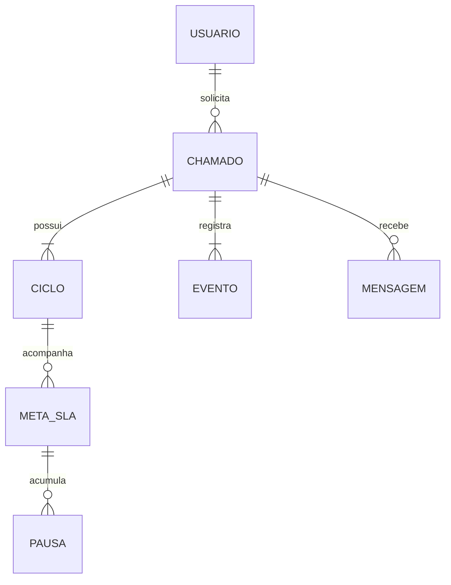

# Modelo de dados inicial — ITSM

Estado: desenho lógico para revisão; não há schema ou migração executada. Requisitos confirmados constam em requisitos.md. As escolhas técnicas abaixo estruturam a persistência; políticas identificadas como pendentes não passam a ser aprovadas por estarem modeladas.

## Convenções

IDs internos estáveis, distintos do número legível do chamado. Instantes persistidos em UTC, com fuso nomeado no calendário para conversão. Intervalos [início, fim), fim nulo quando aberto. Desativação de cadastros referenciados em vez de exclusão em cascata. Campos de auditoria não substituem eventos de negócio.

Mudanças concorrentes usam versão do registro; sua implementação específica será definida nas migrações. Valores monetários e campos de ativos não fazem parte deste modelo.

## Organização e identidade

| Entidade | Campos centrais e relações | Integridade |
| --- | --- | --- |
| Usuario | Id, TenantId, SubjectId, Nome, Email, Ativo, EstadoProvisionamento | Identidade externa única por tenant/subject; e-mail não é chave de identidade |
| Unidade | Id, Nome, Ativa | Usuários referenciam cadastro válido |
| Area | Id, Nome, Ativa | Sem unidade exclusiva: pode abranger várias |
| VinculoOrganizacional | Id, UsuarioId, AreaId, UnidadeId, InicioUtc, FimUtc | No máximo um vínculo vigente por usuário; sem sobreposição histórica |
| GestaoArea | Id, AreaId, GestorUsuarioId, InicioUtc, FimUtc | Uma área operacional tem um gestor vigente; sem sobreposição por área |
| Papel / UsuarioPapel | PapelId, UsuarioId | Concessão apenas por administrador; perfil de gestor depende também do vínculo de gestão |
| GrupoAtendimento | Id, Nome, Ativo | Sistemas, Operações de TI e Audiovisual |
| MembroGrupo | GrupoId, UsuarioId, InicioUtc, FimUtc | Associação vigente única por par |

Usuário provisionado, mas sem vínculo válido, permanece pendente e não pode abrir chamados. É uma proposta de bloqueio seguro enquanto P09 é resolvida, não autorização para cadastro automático de privilégios.

P03 (gestor de várias áreas) permanece aberta. O modelo suporta a associação sem fixar a cardinalidade inversa de negócio. Acesso gerencial a históricos após transferências depende de P05; não conceder acesso apenas porque um ID de área foi incluído no filtro da API.

## Atendimento

| Entidade | Campos centrais e relações | Finalidade |
| --- | --- | --- |
| Categoria | Id, Nome, GrupoPadraoId, Ativa | Encaminhamento dos novos chamados |
| Severidade | Id, Codigo, Nome, Ordem, Ativa | Configuração sem tempos fixos no código |
| RegraImpacto | Id, Versao, Impacto, SeveridadeId, Vigencia | Mapear impacto informado; matriz pendente P06 |
| Chamado | Id, Numero, AbertoPorId, SolicitanteId, VinculoAberturaId, UnidadeAtendimentoId, LocalTexto, Tipo, Titulo, Descricao, CategoriaId, GrupoId, ResponsavelId?, Impacto, SeveridadeId, Estado, CriadoUtc, AtualizadoUtc, Versao | Estado atual para operação |
| CicloAtendimento | Id, ChamadoId, NumeroCiclo, InicioUtc, EncerradoUtc?, Desfecho?, Solucao?, EncerradoPorId? | Preservar cada abertura/reabertura e sua conclusão |
| Mensagem | Id, ChamadoId, AutorId, Visibilidade, Conteudo, CriadoUtc | Resposta pública ou nota interna; política P16 |
| Anexo | Id, ChamadoId, MensagemId?, ChaveArmazenamento, NomeOriginal, Tipo, Tamanho, Hash, Visibilidade, EstadoVerificacao, AutorId, CriadoUtc | Arquivo fora do banco; vínculo autorizado e validação antes de download |
| EventoChamado | Id, ChamadoId, Sequencia, Tipo, VersaoPayload, CicloId?, AtorId?, OcorridoUtc, RegistradoUtc, CorrelationId, Dados | Histórico de alterações relevantes |

O vínculo histórico da abertura referencia a área/unidade daquele instante. A proposta é impedir que transferências reescrevam os relatórios antigos. Renomes de dimensões podem usar rótulo atual; se exigir nome histórico, versionar a dimensão. Não copiar indiscriminadamente dados pessoais em cada evento.

O modelo distingue autor da abertura de beneficiário; acesso do gestor não passa a ser de edição por ele ter criado o chamado. Unidade de atendimento pode ser diferente da unidade de vínculo.

### Invariantes propostas

- Numero único; um único ciclo aberto por chamado.
- Estado Encerrado exige ciclo finalizado com solução e ator. Cancelamento exige motivo, sem ser contado como resolução.
- Responsável principal é único e deve ser técnico autorizado no grupo no momento da atribuição; mudança posterior de vínculo requer tratamento explícito.
- Assunção é operação atômica condicionada a chamado disponível e versão esperada; apenas um concorrente vence.
- Sequencia única e crescente dentro do chamado; ordem não depende apenas do timestamp.
- Anexo e mensagem associados devem pertencer ao mesmo chamado; cliente não escolhe livremente visibilidade de nota interna.
- Mudança de categoria/grupo registra transição. Se responsável não pertence ao destino, solicitar transferência ou devolver à fila; regra operacional pendente P10.

## SLA e calendário

| Entidade | Campos centrais | Integridade |
| --- | --- | --- |
| CalendarioVersao | Id, CalendarioId, Versao, Fuso, Vigencia | Versão aplicada imutável |
| JanelaSemanal | CalendarioVersaoId, DiaSemana, InicioLocal, FimLocal | Sem sobreposições |
| ExcecaoCalendario | CalendarioVersaoId, DataLocal, UnidadeId?, Janelas | Feriados e exceções explícitos; prioridade de exceções documentada |
| PoliticaSLAVersao | Id, PoliticaId, Versao, SeveridadeId, CalendarioVersaoId, PrimeiraRespostaSeg?, ResolucaoSeg?, Vigencia | Tempos configurados pelo administrador; ausência é não configurado, nunca zero |
| MetaSLA | Id, ChamadoId, CicloId?, Tipo, PoliticaVersaoId, InicioUtc, CumpridaUtc?, VioladaUtc?, AlvoSeg, Versao | Relaciona avaliação à regra aplicada |
| PausaSLA | Id, MetaSLAId, InicioUtc, FimUtc?, Motivo, EventoInicioId, EventoFimId? | Sem sobreposição para uma mesma meta |

Cada meta conserva sua política e calendário. Alterações futuras não recalculam retroativamente resultados sem uma operação explícita e auditável. Se houver correção de severidade no chamado, registrar a política anterior, nova aplicação e instante de efeito; comportamento final depende de P07.

O ciclo de atendimento existe independentemente de decidir se o SLA será novo ou continuado na reabertura. P07 permanece aberta. Evitar derivar o histórico inteiro do campo AtualizadoUtc.

## Conhecimento, notificações e auditoria

| Entidade | Relações e conteúdo |
| --- | --- |
| Artigo | Identidade estável, visibilidade, categoria, estado e versão publicada |
| ArtigoVersao | ArtigoId, numero, título, resumo, conteúdo, autor, datas; versões publicadas preservadas |
| ChamadoArtigo | ChamadoId, ArtigoVersaoId, mensagem vinculada opcional; revalidar visibilidade ao mostrar |
| Notificacao | UsuarioDestinoId, evento de origem, link interno, criada/lida, tipo; evitar cópia de texto interno em destinatários externos ao suporte |
| Outbox | EventoId, destino/tipo, payload mínimo, tentativas, próxima tentativa, estado, lease e erro sanitizado |
| Auditoria | Ator, operação, entidade, ID, instante, contexto e alterações sanitizadas |

Outbox grava junto à alteração de negócio. Consumidores repetíveis e deduplicação por evento/destino; envio de e-mail pode ter resultado incerto após falha e não garante exatamente uma entrega. Retenção e expurgo são políticas pendentes P13/P18, inclusive para dados históricos.

## Relacionamento central

Diagrama resumido; autor da abertura, vínculos organizacionais e dimensões constam nas tabelas acima.

## Acesso e índices candidatos

Toda busca parte do escopo autorizado e aplica os filtros solicitados dentro desse escopo. Contagens, exports, anexos e gráficos seguem a mesma política. Snapshot de abertura para BI não concede acesso histórico automaticamente.

Índices candidatos a validar com planos e carga: Chamado(SolicitanteId, CriadoUtc), Chamado(GrupoId, Estado, CriadoUtc), Chamado(ResponsavelId, Estado), EventoChamado(ChamadoId, Sequencia) único, CicloAtendimento(ChamadoId, NumeroCiclo) único, Outbox(Estado, ProximaTentativaUtc). Adicionar índices analíticos apenas após observar consultas; não prometer desempenho por desenho lógico.

Não criar tabelas de ativos, reservas ou agendamentos nesta fase.
